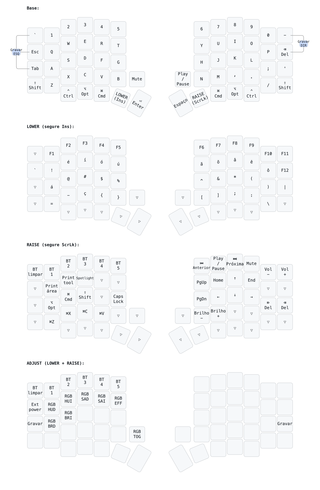

# Meu Sofle (Tupinikeebs) — guia rápido

Teclado: Sofle split wireless, nice!nano v2, ZMK, OLED + encoder.
Fork: https://github.com/ninjaa-exe/sofle-zmk_oled
Clone local: `~/Downloads/git/sofle-zmk_oled`
Firmware baixado: `~/Downloads/sofle-firmware`

## Entrar em modo de gravação (bootloader) sem abrir o teclado

| Metade   | Como |
|----------|------|
| Esquerda | Combo: `` `~ `` + `Esc` + `1 End` juntas (3 teclas de cima da coluna da ponta esquerda) |
| Esquerda | Alternativa: segurar `Ins` (LOWER) + `ScrLk` (RAISE) e apertar `1 End` (TAB) |
| Direita  | Segurar as 2 primeiras teclas da ponta direita (`-_` + `Del`) e DEPOIS apertar a 3ª (`'"`) |
| Direita  | Alternativa: segurar `Ins` (LOWER) + `ScrLk` (RAISE) e apertar `'"` |

- Combo só funciona pra esquerda: no ZMK, combos sempre executam na metade principal (esquerda).
- A direita precisa estar conectada na esquerda (Bluetooth entre metades) pra o reset dela funcionar.
- Último recurso: botão RST físico (debaixo da peça/tampa da OLED), duplo clique rápido.

## Atualizar firmware

1. Editar o layout:
   - Visual: https://nickcoutsos.github.io/keymap-editor/ (login GitHub, escolher o fork, Save)
   - Manual: editar `config/sofle.keymap` e dar push
2. GitHub Actions gera o build (~2-8 min): aba Actions do fork, artefato `firmware`
3. Baixar:
   ```bash
   gh run download -R ninjaa-exe/sofle-zmk_oled -n firmware -D ~/Downloads/sofle-firmware
   ```
4. Uma metade por vez: cabo USB, entrar em bootloader (tabela acima), aparece drive `NICENANO`
5. Copiar o `.uf2` certo (left na esquerda, right na direita):
   ```bash
   cp -X ~/Downloads/sofle-firmware/sofle_left-*.uf2  /Volumes/NICENANO/
   cp -X ~/Downloads/sofle-firmware/sofle_right-*.uf2 /Volumes/NICENANO/
   ```
   - Usar `cp -X`: sem ele o macOS dá `Input/output error` (atributos estendidos).
   - Arrastar pelo Finder também funciona. Aviso de "disco não ejetado" é normal.
   - Não precisa apagar nada do drive.

## Identificar a metade pelo número de série (USB)

- Esquerda: `EC7E67F02DDB7509`
- Direita: `FC42C10BB04A59E3`

```bash
system_profiler SPUSBHostDataType | grep -A6 "nice!nano:"
```



## Layout atual (Mac, "Brasileiro – Pro")

Legenda impressa nas teclas entre parênteses (kit genérico, não bate com tudo).

- Polegar esquerdo (fora → dentro): Ctrl (Home), Option (Num), Cmd (_), LOWER (Ins), Enter (tecla grande)
- Polegar direito (dentro → fora): Espaço (Ctrl grande), RAISE (ScrLk), Cmd (/), Option (Pause), Ctrl (*)
- Knob esquerdo: volume / clique = mute. Knob direito: PgUp/PgDn / clique = play/pause
- `-_` = menos, `Del` = backspace

**LOWER (Ins)**: F1–F12 em cima; `Q` = !; `W E R T` = é í ó ú; `A` = á; `Y U I O P` = ã õ â ê ô; `C` = ç (Shift = Ç); símbolos @ # $ % ^ & * ( ) | = - { } [ ] ; : \
- Maiúscula acentuada: jeito normal do Mac (`'` depois `Shift+A`)

**RAISE (ScrLk)**: fileira de cima esquerda = Bluetooth 1–5 (1ª tecla = limpar pareamento); direita = anterior, play, próxima, mute, vol−, vol+
- Setas em `I J K L`, Home/End ao lado do ↑, PgUp/PgDn em `Y`/`H`
- `Q W E` = print área (⌘⇧4), ferramenta print (⌘⇧5), Spotlight
- `Z X C V` = ⌘Z ⌘X ⌘C ⌘V; `N M` = brilho −/+
- `A S D` = Option, Cmd, Shift (pra combinar com setas)

**LOWER + RAISE**: camada ADJUST (Bluetooth, bootloader)
